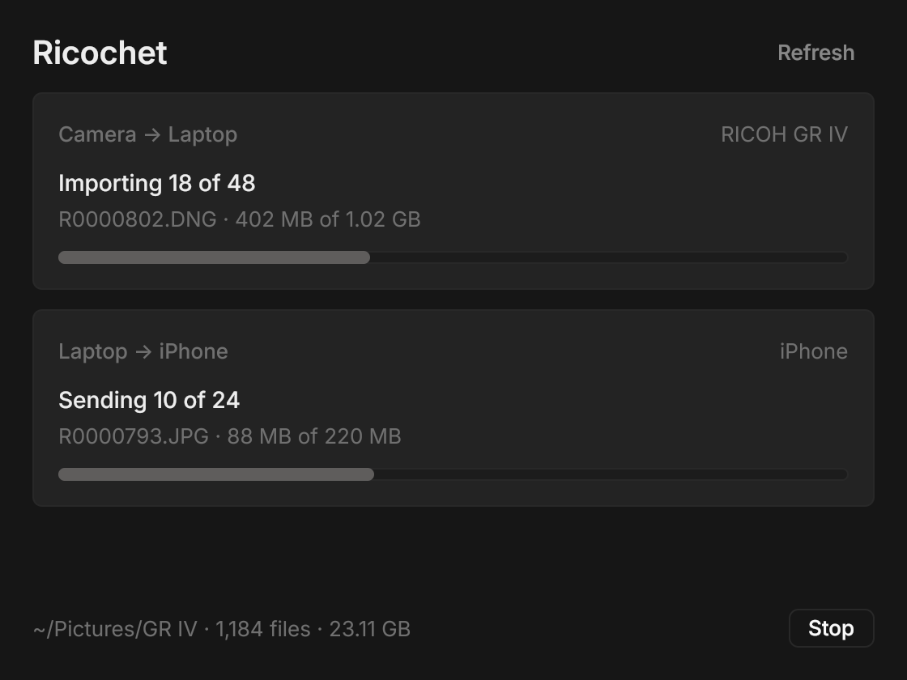

# Ricochet

A desktop app that copies photos from a camera to your laptop, and from the laptop to an
iPhone, with one Sync button. Built with [Rune](https://github.com/anomalyco/rune).



- **Camera → Laptop**: lists the camera over PTP on USB and downloads what the library
  doesn't have yet. It only reads from the camera.
- **Laptop → iPhone**: sends the JPEGs and videos the phone doesn't have yet into an app's
  Documents folder over USB (usbmuxd and AFC, no mounting). It defaults to LocalSend's, which
  shows in Files under On My iPhone → LocalSend. RAW files stay on the laptop; send the ones you
  want with LocalSend itself.

Sync works with whatever is plugged in. With both, each photo goes on to the phone as soon as
it lands on the laptop, so the slower device sets the pace. A photo you delete from the library
or the phone after it was copied stays deleted; Ricochet offers to copy it again.

Ricochet remembers the camera's file list, what it imported and what it sent in
`ricochet.db` in your data folder (`~/.local/share/ricochet` on Linux,
`~/Library/Application Support/ricochet` on a Mac). Deleting it loses no photos: the next
check reads the whole camera again, and deleted photos are offered once more.

Both sides use the same flat layout, so selecting everything on the phone is one tap:

```
~/Pictures/GR IV/RAW/R0000185.DNG
~/Pictures/GR IV/JPG/R0000185.JPG      LocalSend/GR IV/JPG/R0000185.JPG
```

## Install

Download the latest build from [Releases](https://github.com/ghostwriternr/ricochet/releases):

- **Linux (x86_64)**: `ricochet-*-x86_64-linux.tar.gz` holds `ricochet` and `ricochet-cli`.
  It needs `libxkbcommon` and a Vulkan or GL driver. On NixOS, use the flake instead.
- **Mac (Apple silicon)**: `ricochet-*-aarch64-macos.zip` holds `Ricochet.app` and
  `ricochet-cli`. The app isn't notarized, so clear the download flag once before opening it:
  `xattr -dr com.apple.quarantine Ricochet.app`.

With Nix, the flake's `packages.<system>.default` builds both programs from source, plus a
desktop entry on Linux: `nix run github:ghostwriternr/ricochet`, or add the flake as an input.

## Build from source

```sh
nix develop
cargo run --release -p ricochet
```

On Linux, `usbmuxd` must be running and the phone paired ("Trust this computer"). On NixOS
that's `services.usbmuxd.enable = true;`.

`ricochet-cli` does the same without a window: `status`, and `sync [--restore-deleted]`. The
library is `GR IV` in your Pictures folder; `RICOCHET_LIBRARY` overrides it for the CLI.

## Layout

- `crates/ricochet-core`: devices, the library layout, the database, plans and the sync. No UI.
- `crates/ricochet`: the window.

## License

MIT
